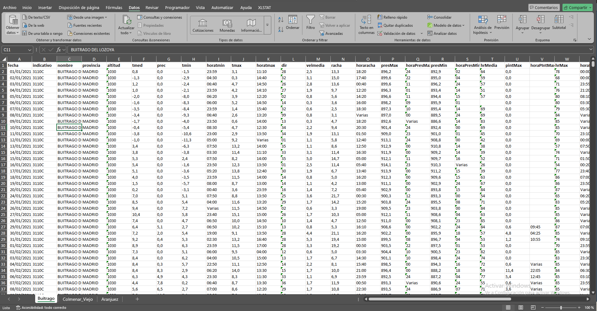

# Climate Data Processing and Quality Control

R workflows for climate data acquisition, NetCDF extraction and quality checks. Includes methods from CEIGRAM and related environmental research, organized by provider.

## Workflows

- **AdapteCCa:** manual THREDDS downloads, NetCDF diagnostics and spatial extraction. See [diagnostics](src/adaptecca/diagnose_netcdf.R) and [extraction](src/adaptecca/extract_sites.R).
- **AEMET:** API-based daily station observations, with separate scripts for [2000–2020](src/aemet/download_daily_2000_2020.R) and [2021–2025](src/aemet/download_daily_2021_2025.R).
- **ROCIO:** [5-km gridded NetCDF extraction](src/rocio/extract_grid_5km.R), adapted from CEIGRAM work.
- **SiAR:** [ET0, precipitation and wind data](src/siar/download_et0_wind.R), adapted from CEIGRAM work.

## Getting started

Install R packages: ncdf4, terra, httr, jsonlite, dplyr, openxlsx. Read the [script guidance](src/README.md), [source provenance](docs/data_sources.md) and [quality checks](docs/quality_control.md).

Configure AEMET_API_KEY and SIAR_TOKEN as local environment variables where needed. Do not upload access credentials or downloaded research data. Original SiAR credentials should be rotated before reuse.

The code is provided as portfolio examples and has not been verified end-to-end with original datasets or authenticated API calls. The ROCIO and SiAR workflows are independent CEIGRAM-related work, not automatically part of the doctoral analyses.

## Quality-control demonstration (synthetic data)

The repository includes a [workflow diagram](docs/workflow.md), a [daily QC report generator](src/quality_control/daily_qc.R), a [temporal diagnostic plot script](src/visualization/plot_daily_diagnostics.R), an [illustrative ROCIO nearest-cell map script](src/visualization/plot_rocio_grid.R), and [synthetic reproducibility tests](tests/test_daily_qc.R).

The [example QC table](docs/synthetic_example.md) uses an intentionally artificial seven-day series. It illustrates detection of missing dates, duplicate dates and missing values, **not real climate results**.

From the repository root, with R installed:

```bash
Rscript tests/test_daily_qc.R
Rscript tests/generate_synthetic_data.R outputs/synthetic/daily.csv
Rscript src/quality_control/daily_qc.R outputs/synthetic/daily.csv outputs/synthetic/qc.csv
Rscript src/visualization/plot_rocio_grid.R outputs/synthetic/rocio_grid.png
```

The time-series plot script requires unique dates, so resolve the deliberate duplicate in the synthetic fixture before plotting. The map uses an **invented illustrative grid**, not actual ROCIO raster cells. Original datasets and authenticated API responses have not been tested in this environment.

## AEMET output example

The following screenshot was supplied by the repository author and shows an AEMET daily meteorological data worksheet for Buitrago del Lozoya (station code 3110C), with workbook tabs for Colmenar Viejo and Aranjuez. It illustrates the output format; it does not establish data completeness, validation or permission to redistribute the underlying dataset.



## Daily ET0 time-series figure (2024–2025)

The following author-provided figure displays daily reference evapotranspiration (ET0) series labelled Ciudad Rodrigo, Muñogalindo and Zarza de Granadilla for 2024–2025. The figure itself states its source as "datos diarios facilitados"; the specific provider, calculation method and reuse conditions have **not yet been independently confirmed**. It is therefore shown as a supplied figure, not as independently validated SiAR results.


## Related repositories

- [SIMPAST grassland climate model](https://github.com/AdrianBerzal97/Mediterranean-grassland-climate-model)
- [MODIS NDVI time-series analysis](https://github.com/AdrianBerzal97/MODIS-NDVI-time-series-analysis)

No license has been selected.
