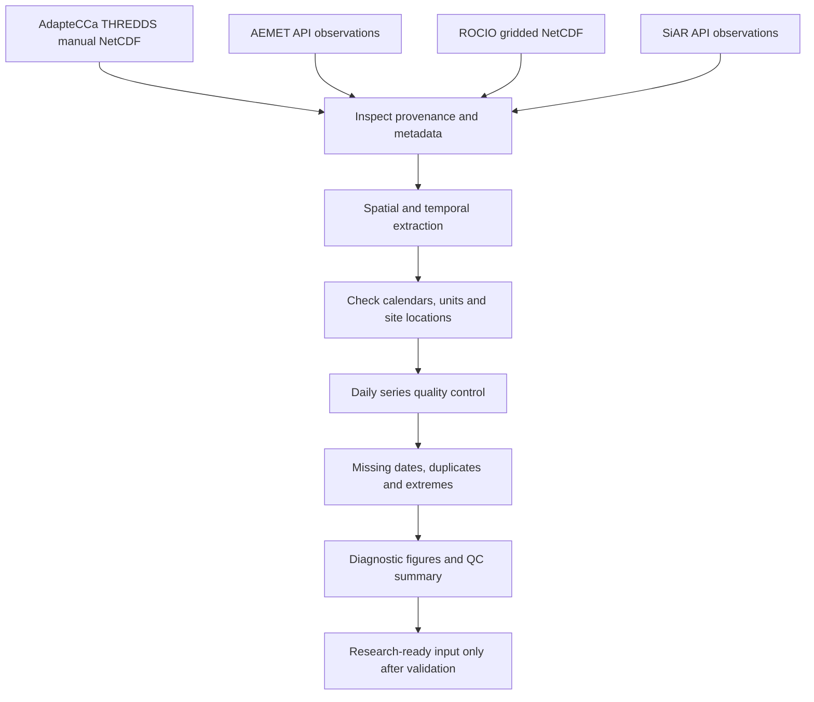

# Climate data processing workflow

Sources have distinct spatial supports and temporal coverages. Arrows show the conceptual workflow, **not** an automated end-to-end pipeline. THREDDS downloads are manual and original data are excluded.
